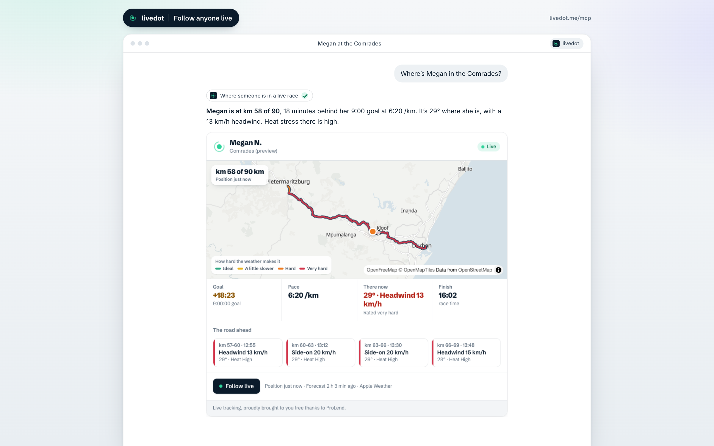
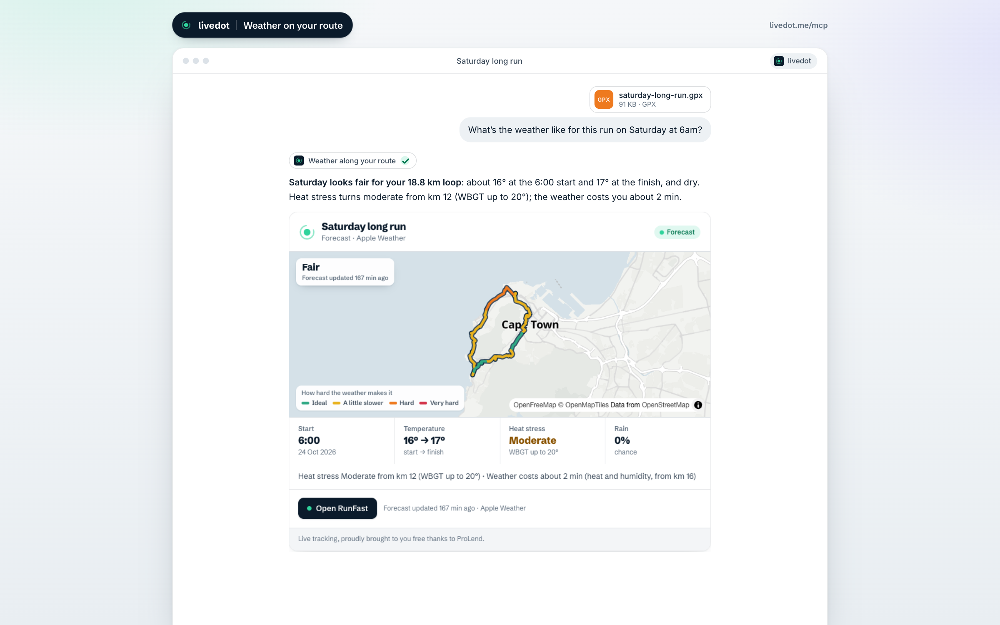
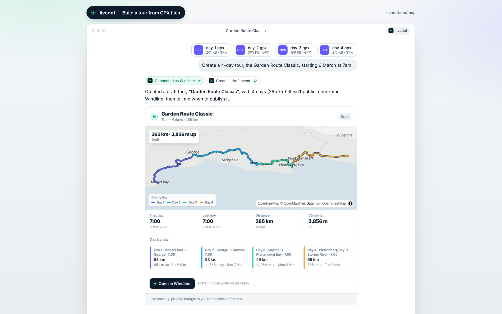
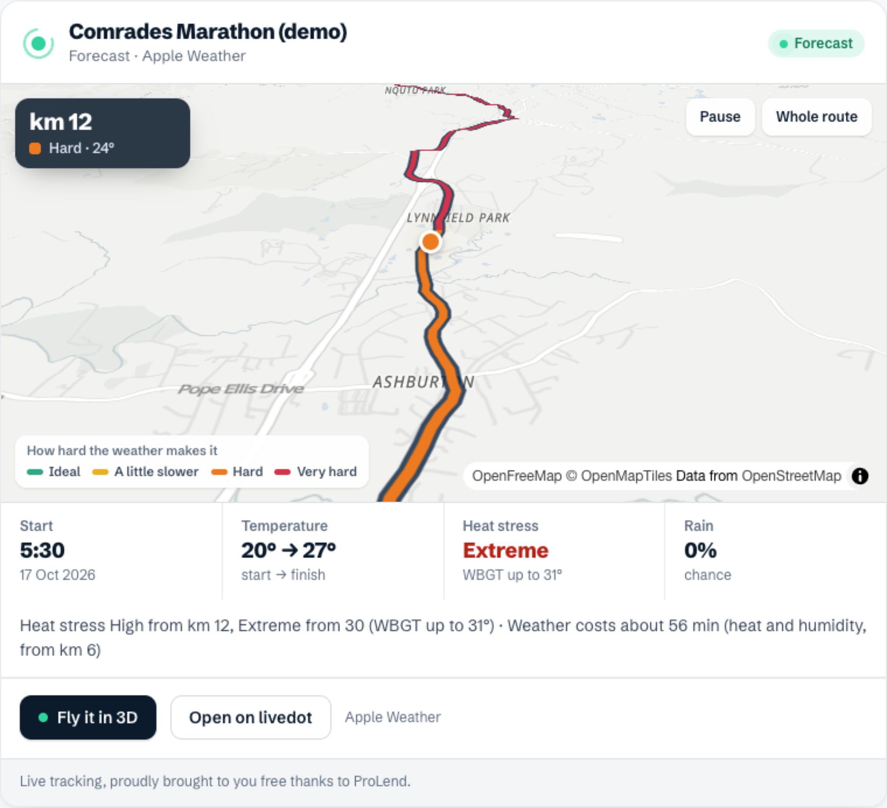
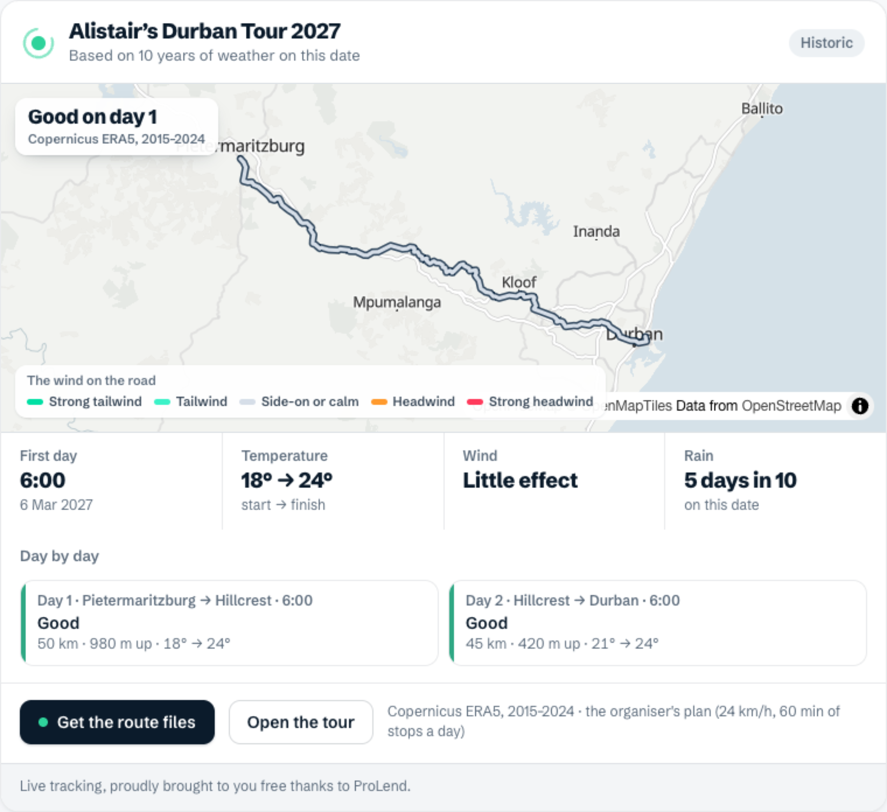

<div align="center">


# livedot MCP

**Live race tracking, in ChatGPT and Claude.**

Ask where someone is in a race, how it's going, or what race day will be like, and get the answer with a live map in the chat.

[](https://registry.modelcontextprotocol.io/v0/servers?search=me.livedot)
[](https://smithery.ai/server/livedot)
[](https://glama.ai/mcp/servers)
[](LICENSE)

`https://livedot.me/mcp` · free · no sign-in · read-only

</div>



<table>
<tr>
<td width="50%"></td>
<td width="50%"></td>
</tr>
</table>

<!-- GIF slot (10–15 s): docs/demo.gif — the question typed, the picker, a tap, the live map, then "Fly the Comrades" playing. -->

## Try it in 30 seconds

The server URL is `https://livedot.me/mcp` (Streamable HTTP). No key, no account, no headers.

**ChatGPT**
1. **Settings → Apps & Connectors → Advanced settings**: turn on **Developer mode**.
2. **Create**: name `livedot`, MCP server URL `https://livedot.me/mcp`, authentication **No authentication**.
3. Ask: *“Where’s the demo runner in the Comrades demo?”*

**Claude** (web and desktop)
1. **Settings → Connectors → Add custom connector**.
2. Name `livedot`, URL `https://livedot.me/mcp`.
3. Ask: *“Fly the Comrades.”*

**Claude Code**
```bash
claude mcp add --transport http livedot https://livedot.me/mcp
```

**Cursor** (`~/.cursor/mcp.json`)
```json
{ "mcpServers": { "livedot": { "url": "https://livedot.me/mcp" } } }
```

Any other MCP client: point it at `https://livedot.me/mcp`.

## What you can ask

Real answers, word for word, on sample data and the apps' demo races.

**“Where’s Megan in the Comrades?”** (`find_person`, then `where_is`)
> I found 20+ Megans in the Comrades. Here are the 5 most likely:
> 1. Megan N. (livedot.me/megan), km 58, 6:20 /km, 18 min behind goal
> 2. Megan B., km 61, 5:58 /km
> 3. Megan N., km 66, 5:32 /km
> …

> Megan N. is at km 58 (mile 36) of 90 km (56 mi) in the Comrades, 18 minutes behind the goal (9:00:00). Running at 6:20 /km (10:12 /mi). Where Megan is: 31°C (88°F), calm air at 5 km/h (3 mph), rated very hard (heat stress Extreme). The road ahead (km 57–69) rates Tough: Heat stress Extreme from km 57 (WBGT up to 32°) · Weather costs about 9 min (heat and humidity, from km 57). At this pace Megan finishes around 11:43 race time.
> Follow live: https://livedot.me/megan
>
> Live tracking, proudly brought to you free thanks to ProLend.

**“Fly the Comrades”** (`fly_route`)
> Here's the Comrades Marathon (demo) course from the air: 90 km (56 mi), with the weather along it. Press play on the map to fly it. … Rated Tough (Heat stress High from km 12, Extreme from 30 (WBGT up to 31°)). About 20°C (68°F) at the start and 27°C (81°F) at the finish. …
> Fly it in 3D: https://runfast.tech/live/race/comrades-demo



**“What will the weather be like for the NYC Marathon?”** (`event_weather`)
> TCS New York City Marathon 2026: Sunday 1 November 2026, start 10:20 AM. Based on 10 years of weather on this date (Copernicus ERA5, 2015–2024), not a forecast. Rated Good. About 55°F (13°C) at the start and 58°F (14°C) at the finish. Heat stress Low. Rain on about 3 days in 10. …
> More: https://livedot.me/guides/nyc-marathon-2026-weather/

**“What’s the ProLend 2027 Durban Tour route? Give me the GPX files.”** (`tour_route`)
> ProLend 2027 Durban Tour: 6 days, 771 km (479 mi).
> Day 1: Johannesburg to Villiers, 164 km (102 mi), 1,185 m of climbing, start 6:00.
> …
> Day 6: Greytown to Ballito, 134 km (83 mi), 1,883 m of climbing, start 6:00.
> The organiser hasn't made the route files available.



**More to try:** *“How’s the Coast Classic demo going?”* · *“Is Thandi racing?”* · *“Weather for the Gravel Burn?”* · *“What should I pack for the Durban tour?”* · *“What will the wind be like on this route on Saturday at 6?”* (attach a GPX) · signed in: *“Make my Saturday bunch ride a weekly club ride from this route.”*

## Tools

| Tool | What it does |
|---|---|
| `find_person` | Finds someone racing live by name, livedot handle (`@megan`, `livedot.me/megan`) or follow link. One clear match answers at once. Several become a picker ranked live first, then the handle's owner, name closeness and taps on the back; the assistant asks one short question and never guesses. Narrow with `event`, `surname`, `bib`, `club`, `place`, `wave`. |
| `where_is` | Where someone is now: km and mile, time against their goal, pace, finish time, the temperature and wind there with the engine's rating, the next few km of wind and heat, and Follow live. |
| `event_status` | How a live race is going: how long it's been under way, how many are on the map, how many finished, who's in front. |
| `event_weather` | Race-day weather along the course at the times people get there. Inside 10 days, the live forecast; beyond, 10 years of weather on the date, labelled as history. |
| `fly_route` | A flyover of the course in the chat, coloured by the weather along it, with **Fly it in 3D**. |
| `tour_route` | A Windline cycling tour by name or organiser: every day (from and to, distance, climbing, start time), the map and the weather. A GPX link for each day only when the organiser shares route files; otherwise it says so. |
| `tour_notes` | *Beta.* A tour organiser's own notes for riders (what to pack, meeting points), quoted in their words. |

| `plan_route` | The weather along your own route (a GPX file or a Ride with GPS link) at the time you'll ride or run it: the forecast inside 10 days, 10 years of weather beyond. Several files are one multi-day tour, ordered as `create_event` orders them. No account. |

### For organisers and club admins (sign in)

Connect your **Windline** or **RunFast** account and the assistant can work on your own events, exactly as your dashboard lets you:

| Tool | Scope | What it does |
|---|---|---|
| `list_my_events` | events.read | Your events: drafts, published and private, dates, distance, finished or not, with links; and the club and organiser pages you run. |
| `create_event` | events.write | A ride, tour or race (Windline) or run or race (RunFast) from GPX files or links. Drop in several files and it's a tour: days ordered by the numbers in the file names (else by the map), named from the towns at each end, one day after another from your start; you check the plan once, then it's made. **Private** (just you: My Rides with its own private link, or a private run) or **shared** (a draft for a group, public once you publish it). Your tour notes for riders, up to 10,000 characters. |
| `update_event` | events.write | Name, description, notes, start dates and times. Never a finished event. |
| `add_tour_notes` | events.write | A Windline tour's notes for riders (what to pack, meeting points). |
| `publish_event` | events.publish | Publishes a draft, only after you confirm. Private events stay private. |
| `post_club_ride` | clubs.post | A draft group ride or club run on a club or organiser page you run (always the club's, never private). If you run a club and don't say who a ride is for, the assistant asks first. |

> “Make a two-day tour from these GPX files, starting 6 March at 6:00.” → a draft on your dashboard, with the weather for both days.

**How sign-in works.** OAuth 2.1 with PKCE and dynamic client registration, following the MCP authorization spec. livedot.me is the issuer (`/.well-known/oauth-protected-resource`, `/.well-known/oauth-authorization-server`) and passes `/oauth/*` to the authorization server, which runs on Windline (its Firestore holds the clients and the hashed tokens, server-only). You choose Windline or RunFast, then sign in on that app's own site (`windline.tech/livedot/` or `runfast.tech/livedot/`) with the sign-in you already use (Apple, Google or email), so nothing about your password ever reaches livedot or the assistant. Access tokens last 15 minutes and refresh tokens 30 days, rotated on every use. Disconnect any time from **Account → AI assistants** in Windline or RunFast: it stops at once. Read tools and `plan_route` never need an account. Before you allow, the sign-in page shows where you'll be sent back to ("chatgpt.com", or "an app on this computer"); only ChatGPT returning to its own site and Claude returning to its own are shown as verified, and any other app is marked as unverified with the name it gave itself. Apps must return to an https address or to this computer.

Every tool declares a human title, honest annotations (`readOnlyHint`, `destructiveHint`, `idempotentHint`, `openWorldHint`) and an `outputSchema` for its `structuredContent` (`src/schemas.js`).

**Prompts.** `track_someone` (Track someone in a race), `race_day_weather` (Race-day weather) and `fly_a_course` (Fly a course). **Resources.** The live map (`ui://livedot/live-map.html`) and a short guide (`livedot://guide`). A static server card is at `/.well-known/mcp/server-card.json`.

On the free paths (no sign-in) an answer ends with one line to a free Windline or RunFast account (`?ref=mcp`), before the sponsor line; never on a signed-in answer.

Every tool takes `units`: `metric` or `imperial`. Without it, the asker's region decides (ChatGPT sends it); with neither, the event's country leads and the other system follows in brackets: “km 79 (mile 49)”. All tools are read-only (`readOnlyHint`).

## How it works

- **Live, from the apps.** Positions, goals and finish times come from [Windline](https://windline.tech) (cycling) and [RunFast](https://runfast.tech) (running): the same public live pages anyone can open on [livedot.me](https://livedot.me).
- **One forecast engine.** Weather by the Windline engine, served from livedot.me: the same engine as the apps and every livedot page, so the numbers match everywhere. Apple Weather for the next 10 days; 10 years of Copernicus ERA5 records beyond. The engine is Windline's and isn't in this repository or under its licence: `scripts/build.mjs` fetches it from `windline.tech/engine-core.js` when the server is built.
- **A map in the chat.** One [MCP Apps](https://modelcontextprotocol.io) UI resource (`ui://livedot/live-map.html`) that Claude and ChatGPT render inline: always a light map (OpenFreeMap), never a per-tile map key. Clients without widgets get the full answer as text.

**Privacy.** Only people who chose to be findable, on public races; the organiser tools only ever touch the signed-in person's own events; no position when someone has stopped or is near the start or finish; names as “Megan N.”; nothing kept about who asked.

## For the auditor

A position (km, mile, map dot, the weather there) is shared only when the public follow answer gives one and the person is moving (live, delayed, no signal). Paused, stopped, not started, hidden near the start or finish, private or not shared: “I can't share where they are right now.” Route files only when the organiser's own switch (`routeFiles`) is on. Every read is in `src/reads.js`.

## Develop

```bash
node scripts/build.mjs                 # fetch the engine, build the widget and the event list
node test/smoke.mjs                    # every tool, on sample data and the apps' public demos
node test/fixture-api.mjs              # sample data on :8790
npx @modelcontextprotocol/inspector    # connect to your server's /mcp (Streamable HTTP)
MCP=http://localhost:8788/mcp node test/shots.mjs   # the screenshots in docs/shots, at 3x
```

`src/server.js` is the whole server (`handle(request, env)`); on livedot.me it runs as a Cloudflare Pages Function. `src/schemas.js` holds the tools' output schemas and the prompts.

## Keywords

Live tracking · race tracker · marathon tracker · cycling race tracking · Comrades tracker · marathon weather · race-day weather forecast · cycling tour GPX · ChatGPT app · Claude connector · MCP server · Model Context Protocol

## Links

[livedot.me](https://livedot.me) · [windline.tech](https://windline.tech) (cycling) · [runfast.tech](https://runfast.tech) (running) · [Privacy](https://livedot.me/privacy) · [Terms](https://livedot.me/terms) · hello@windline.tech

*Live tracking, proudly brought to you free thanks to ProLend.*

MIT licensed. The Windline forecast engine is not part of this repository.
